# BINOFIT — Diagramme du modèle de données

Diagramme Entité-Association correspondant au modèle décrit dans `/specs/data-model.md`
et au schéma `/specs/schema.sql` (Supabase Postgres). Les noms sont ceux des colonnes
en base (`snake_case`).

```mermaid
erDiagram
    USERS ||--o{ USER_SPORTS : "pratique (user_id)"
    USERS ||--o{ USER_AVAILABILITY : "est disponible (user_id)"
    USERS ||--o{ ACTIVITIES : "propose (created_by)"
    USERS ||--o{ ACTIVITIES : "est invité (guest_id)"
    ACTIVITIES |o--o{ CONVERSATIONS : "activity_id (optionnel)"
    CONVERSATIONS ||--|{ PARTICIPANTS : "a pour membres"
    USERS ||--o{ PARTICIPANTS : "participe (user_id)"
    CONVERSATIONS ||--o{ MESSAGES : "contient (conversation_id)"
    USERS ||--o{ MESSAGES : "envoie (sender_id)"
    USERS ||--o{ FAVORITES : "possède (user_id)"
    FAVORITES }o..|| USERS : "cible (target_id, si target_type=user)"
    FAVORITES }o..|| ACTIVITIES : "cible (target_id, si target_type=activity)"

    USERS {
        text id PK
        text email
        text first_name
        text last_name
        text bio
        text avatar_url
        text city
        float8 lat
        float8 lng
        timestamptz created_at
        timestamptz updated_at
    }

    USER_SPORTS {
        text user_id PK, FK
        text sport PK
        text level
    }

    USER_AVAILABILITY {
        bigint id PK
        text user_id FK
        text day_of_week
        text start_time
        text end_time
    }

    ACTIVITIES {
        text id PK
        text created_by FK
        text guest_id FK
        text sport
        timestamptz start_at
        text lieu_nom
        float8 lieu_lat
        float8 lieu_lng
        text message
        text status
        text media_url
        text media_type
        timestamptz created_at
    }

    CONVERSATIONS {
        text id PK
        text activity_id FK
        timestamptz created_at
        timestamptz updated_at
    }

    PARTICIPANTS {
        text conversation_id PK, FK
        text user_id PK, FK
    }

    MESSAGES {
        text id PK
        text conversation_id FK
        text sender_id FK
        text text
        timestamptz sent_at
    }

    FAVORITES {
        text id PK
        text user_id FK
        text target_type
        text target_id
        timestamptz created_at
    }
```

## Notes de lecture

- `USERS ||--o{ USER_SPORTS` / `USER_AVAILABILITY` : sports (un niveau par sport) et créneaux
  récurrents d'un utilisateur, supprimés avec lui (`on delete cascade`).
- `USERS ||--o{ ACTIVITIES` (propose / est invité) : chaque activité a un seul créateur
  (`created_by`) et un seul invité (`guest_id`), toujours différents
  (`check (created_by <> guest_id)`) — jamais de liste de participants.
- `ACTIVITIES |o--o{ CONVERSATIONS` : une conversation peut découler d'une activité
  (`activity_id`, mis à `null` si l'activité est supprimée). Le champ API
  `activity.conversationId` est déduit de ce lien, il n'est pas stocké.
- `CONVERSATIONS ||--|{ PARTICIPANTS` / `USERS ||--o{ PARTICIPANTS` : relation N—N entre
  utilisateurs et conversations ; `participantIds` dans l'API vient de cette table.
- `CONVERSATIONS ||--o{ MESSAGES` : les messages sont dans Postgres ; `lastMessage` dans
  l'API est le message le plus récent de la conversation.
- `FAVORITES` cible soit un `USERS`, soit une `ACTIVITIES`, selon `target_type` (relation
  polymorphe sans clé étrangère, représentée par les deux liens en pointillés) ; le
  triplet (`user_id`, `target_type`, `target_id`) est unique.

## Répartition par base de données

| Table               | Base de données          |
| ------------------- | ------------------------ |
| `users`             | Supabase Postgres (Paris) |
| `user_sports`       | Supabase Postgres (Paris) |
| `user_availability` | Supabase Postgres (Paris) |
| `activities`        | Supabase Postgres (Paris) |
| `conversations`     | Supabase Postgres (Paris) |
| `participants`      | Supabase Postgres (Paris) |
| `messages`          | Supabase Postgres (Paris) |
| `favorites`         | Supabase Postgres (Paris) |

Firebase Authentication ne stocke que les comptes de connexion ; `users.id` reprend
l'uid Firebase.
