# BINOFIT — Diagramme de classes UML

Diagramme de classes des 8 entités du modèle, avec les noms et types des colonnes de
[specs/schema.sql](../specs/schema.sql) (Supabase Postgres). Description des champs et
correspondance avec l'API : [specs/data-model.md](../specs/data-model.md). Diagramme
Entité-Association : [docs/data-model.md](data-model.md).

```mermaid
classDiagram
    direction LR

    class User {
        <<table users>>
        +text id PK
        +text email
        +text first_name
        +text last_name
        +text bio
        +text avatar_url
        +text city
        +double_precision lat
        +double_precision lng
        +timestamptz created_at
        +timestamptz updated_at
    }

    class UserSport {
        <<table user_sports>>
        +text user_id PK FK
        +text sport PK
        +text level
    }

    class UserAvailability {
        <<table user_availability>>
        +bigint id PK
        +text user_id FK
        +text day_of_week
        +text start_time
        +text end_time
    }

    class Activity {
        <<table activities>>
        +text id PK
        +text created_by FK
        +text guest_id FK
        +text sport
        +timestamptz start_at
        +text lieu_nom
        +double_precision lieu_lat
        +double_precision lieu_lng
        +text message
        +text status
        +text media_url
        +text media_type
        +timestamptz created_at
    }

    class Conversation {
        <<table conversations>>
        +text id PK
        +text activity_id FK
        +timestamptz created_at
        +timestamptz updated_at
    }

    class Participant {
        <<table participants>>
        +text conversation_id PK FK
        +text user_id PK FK
    }

    class Message {
        <<table messages>>
        +text id PK
        +text conversation_id FK
        +text sender_id FK
        +text text
        +timestamptz sent_at
    }

    class Favorite {
        <<table favorites>>
        +text id PK
        +text user_id FK
        +text target_type
        +text target_id
        +timestamptz created_at
    }

    User "1" *-- "0..*" UserSport : user_id
    User "1" *-- "0..*" UserAvailability : user_id
    User "1" --> "0..*" Activity : created_by
    User "1" --> "0..*" Activity : guest_id
    Activity "0..1" --> "0..*" Conversation : activity_id
    Conversation "1" *-- "0..*" Participant : conversation_id
    User "1" *-- "0..*" Participant : user_id
    Conversation "1" *-- "0..*" Message : conversation_id
    User "1" --> "0..*" Message : sender_id
    User "1" *-- "0..*" Favorite : user_id
    Favorite "0..*" ..> "0..1" User : target_id si target_type = user
    Favorite "0..*" ..> "0..1" Activity : target_id si target_type = activity
```

## Notes de lecture

- Composition (`*--`) : la ligne liée est supprimée avec son parent (`on delete cascade`) ; flèche simple (`-->`) : clé étrangère sans cascade (`activities`, `messages.sender_id`), ou `on delete set null` pour `conversations.activity_id`.
- Dépendances en pointillés (`..>`) : `favorites.target_id` n'a pas de clé étrangère ; la cible est un `User` ou une `Activity` selon `target_type`, vérifiée par le Worker.
- `double_precision` note le type Postgres `double precision` (un type Mermaid ne peut pas contenir d'espace) ; `status`, `media_type` et `target_type` sont contraints par un `check`, les autres énumérations sont validées par le Worker.
